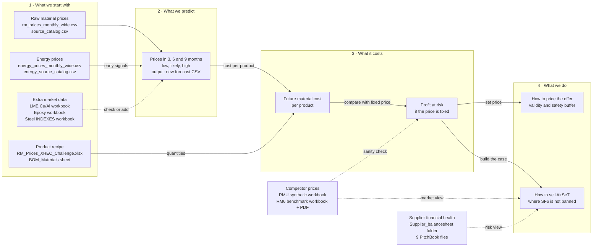
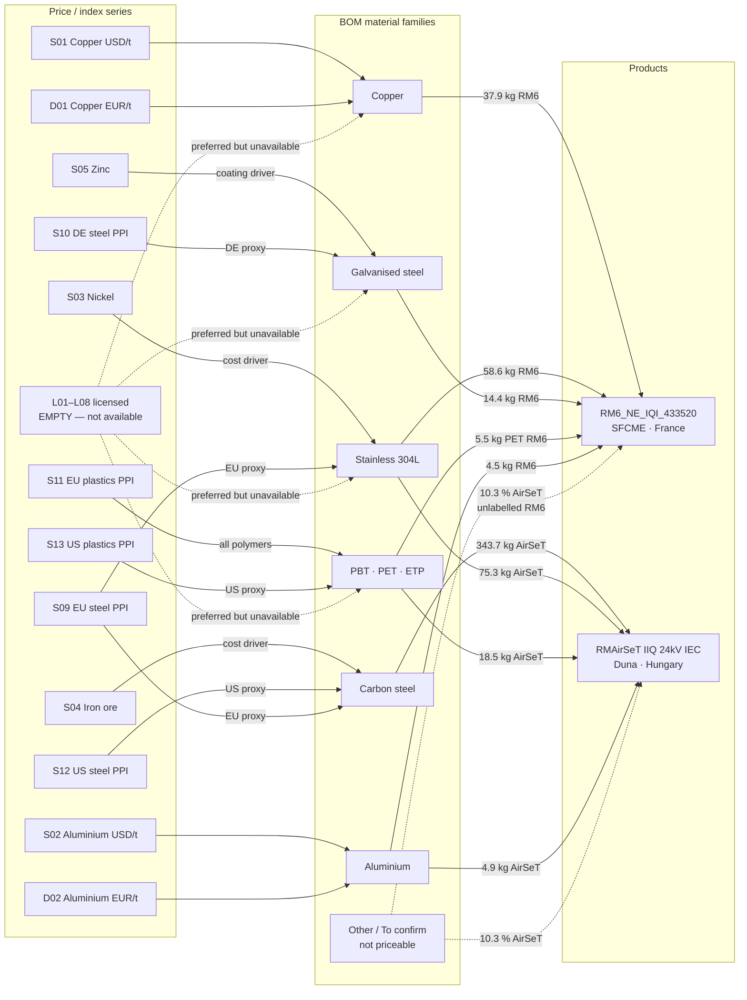
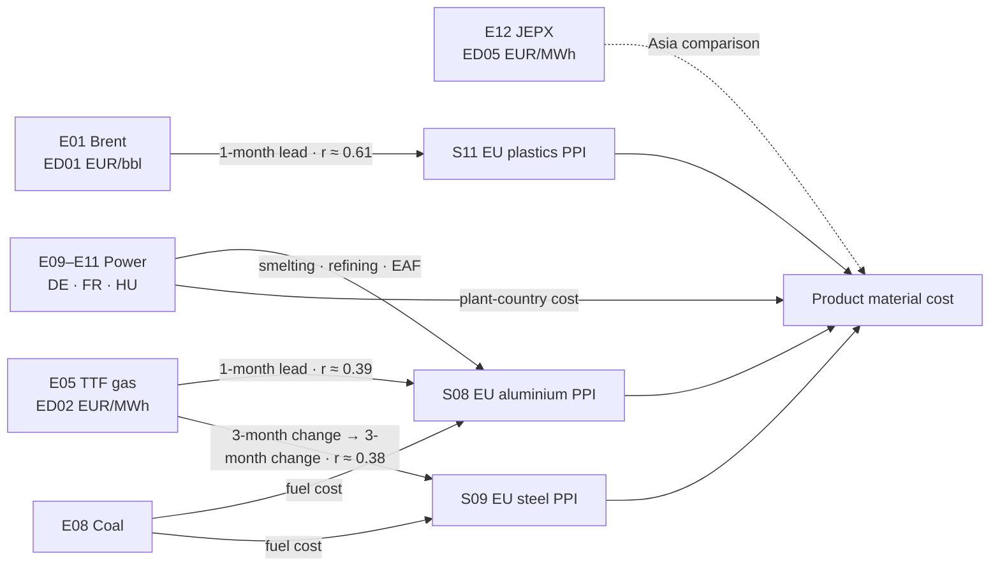
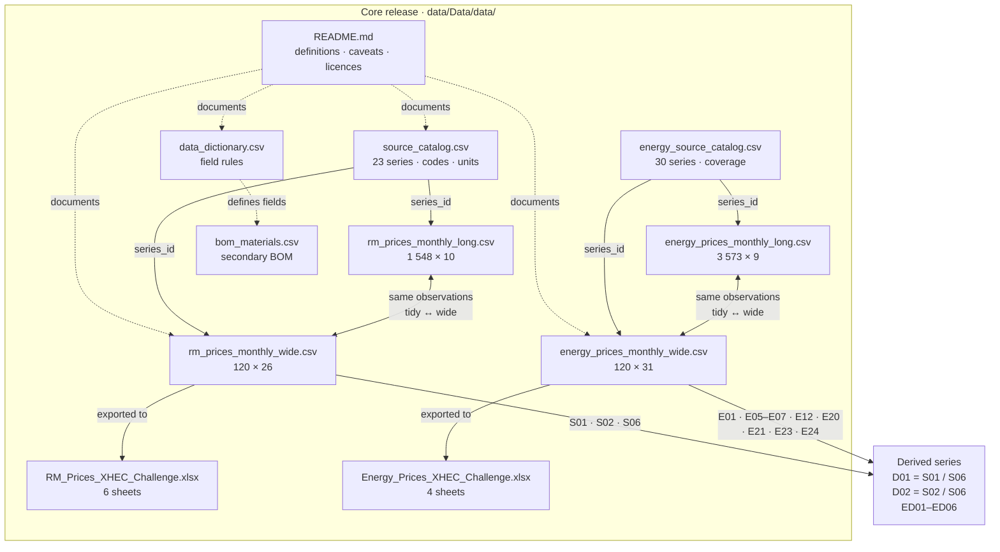

# Data understanding and source precedence

## Current architecture — November 2026 migration

`data/RM_Prices_XHEC_Challenge_v1.xlsx` is authoritative wherever its contents overlap with prior sources. Actual inspection found one sheet, `BOM_Materials`, with 22 material rows and five summary rows. It contains no monthly prices, source catalog, currencies or publication timestamps. The loader separates summary metadata from material observations.

The retained `data/data/RM_Prices_XHEC_Challenge.xlsx` supplies the price panels, FX, source catalog and dictionary; its embedded BOM is superseded. The independent energy workbook supplies energy and regional FX history. The prior standalone BOM and CSV exports are preserved locally in `data/.archive/before_v1/`; uncertain cloud exports are archived without permanent deletion. Supplementary market and supplier sources remain available for reconciliation and context.

The generated current catalog, numerical quality findings, BOM differences, EDA comparisons and executed notebook are under ignored `data/eda_presentation/`. The inventory and sheet inspections are under ignored `data/audit/`. See [README](../README.md) for reproducible commands. September-origin selection uses the explicit September 30 decision cutoff and separately labeled lag assumptions; it does not establish verified historical availability.

## Historical Issue #2 audit (superseded snapshot)

The audit below is preserved as historical evidence. Its old paths, row counts, BOM precedence and missing-field findings describe the pre-v1 snapshot and must not override the current architecture above or the generated current catalog.


This document contains a brief overview of the different documents in our given dataset.

For unclear terms, see the [glossary](glossary.md).

## Tree summary of files

```
├── Data
│   ├── data/                               Prioritize this for raw material price forecast
│   │   ├── bom_materials.csv                   table giving each product's material family, mass (kg), mass share.
│   │   ├── data_dictionary.csv                 field dictionary defining every column's type, unit, allowed values.
│   │   ├── energy_prices_monthly_long.csv
│   │   ├── energy_prices_monthly_wide.csv
│   │   ├── Energy_Prices_XHEC_Challenge.xlsx
│   │   ├── energy_source_catalog.csv           a list of different energy sources
│   │   ├── README.md                           useful information on the data
│   │   ├── rm_prices_monthly_long.csv
│   │   ├── rm_prices_monthly_wide.csv
│   │   ├── RM_Prices_XHEC_Challenge.xlsx
│   │   └── source_catalog.csv
│   ├── Supplier_balancesheet/
│   │   ├── PitchBook_******.xlsx                              Information on Raw material suppliers, use for risk analysis
│   ├── benchmark-modules-fonctionnels-[...].pdf
│   ├── benchmark-modules-fonctionnels-[...].xlsx
│   ├── Copia de Europe Steel INDEXES.xlsx
│   ├── Epoxy for student.xlsx
│   ├── LME_Copper_Aluminium_EU_Monthly_2016_2026.xlsx
│   ├── RM_Prices_XHEC_Challenge.xlsx
│   ├── RMU_IQI_EU_Price_Benchmark_2017-2026_Synthetic.xlsx
│   └── X_HEC_2026_Pres.pdf
```

**The difference between long & wide**: Contains the exact same data, but just arranged differently:

- Wide: Each series (different energy source or raw material) is a column. Each row is a given month.

```csv
month,S01,S02,S06
2016-11-01,5450.93,1737.11,1.0799
2016-12-01,5660.35,1727.74,1.0543
```

- Long: Each row is an observation for an independent series. Different series jumbled up together in here.

```csv
month,series_id,value,unit,source
2016-11-01,S01,5450.93,USD/t,IMF via FRED
2016-11-01,S02,1737.11,USD/t,IMF via FRED
2016-11-01,S06,1.0799,USD per EUR,ECB
2016-12-01,S01,5660.35,USD/t,IMF via FRED
```

## 1. Summary

This data challenge concerns raw-material and Bill-Of-Materials (BOM) cost forecasting for Engineer-To-Order (ETO) pricing and gross-margin protection, while using market evidence to inform competitive pricing. In simple terms, we predict the a range of prices (10%, 50%, 90% percentiles) of raw materials.

The challenge forecast origin is **September 2026**. Required forecast targets are **December 2026 (3 months), March 2027 (6 months), and June 2027 (9 months)**.

See the below flowchart on how each piece of information would be used.




## 2. BOM composition

The following chart covers the list of materials and how they influence the rest of the supply chain.



## 3. Energy as leading indicators




## Remaining open questions

1. What durable identifier should distinguish material rows from summary rows in each authoritative BOM configuration?
2. Can Schneider Electric clarify the missing authoritative quantities, mass shares and regional price mappings without silently substituting secondary versions?
3. Which materials, purchase basis, geography, currencies and approved baseline spend define the intended partial monetary BOM index?
4. What is the exact September 2026 forecast cutoff, and can historical publication vintages/availability timestamps be supplied for each series?
5. Which RM series and energy features are approved targets/features for each product and market? Are global commodity benchmarks suitable to local purchasing exposure?
6. What source, synthetic-generation process, ML method and quantile interpretation apply to the RMU benchmark, and what uses are permitted?
7. Which competitor configurations, markets, VAT basis, currency and commercial terms make price comparisons valid?
8. What are the approved product mappings and distinctions among RM6/RM AirSeT and SM6/SM AirSeT?
9. Which inflation series is approved, and should it be tested as deflation/reinflation, an exogenous feature, or both?
10. What licenses, retention rules and publication restrictions apply to steel indices, supplier reports, competitor files and the October 2026 market report?
### Reproducibility

The audit used read-only CSV parsing, workbook sheet/header and formula/error inspection, keyed panel comparisons, archive-integrity/hash checks, monthly-calendar checks, and descriptive outlier/seasonality screens. No dependencies were installed; no source files were changed, no cleaned or merged dataset was written, no model was trained, and nothing was committed or pushed.


## 3. Dataset classification and business relevance

| Classification | Datasets | Business use and readiness |
|---|---|---|
| Raw-material forecasting targets | S01/S02 direct prices; D01/D02 derived EUR prices; selected material PPIs S07–S13 if explicitly modeled as indices. | Candidate series for 3/6/9-month forecasting. Targets must match validated BOM material, region, unit and business cost basis. |
| Cost drivers / exogenous variables | S03–S05; S06 FX; energy E/ED series; auxiliary LME, epoxy and steel series after validation. | Potential explanatory features, not automatically causal or available at forecast time. |
| BOM and product cost modeling | Standalone BOM workbook; RM catalog and price series. | Partial monetary index only where authoritative quantities and compatible direct prices are validated. Mass weighting is a separate proxy method. |
| Competitive benchmarking and pricing | Readable RMU synthetic benchmark; provisional RM6 benchmark workbook and PDF. | Market context and scenario comparison only after product/configuration, market, currency, tax and commercial-term comparability checks. |
| Market intelligence | RMU and RM6 material; any October 2026 market report. | Contextual evidence, not actual margin outcomes; October report is retrospective only. |
| Supplier financial risk | Nine supplier workbooks and archive. | Separate controlled analysis (scorecard in `scripts/cli.py supplier`); the supplier-to-material link is inferred from public descriptions (`scripts/cli.py supplier`), not confirmed by Schneider, and it is not a monthly price-forecast target. |
| Reference documentation | Core README, data dictionary, source catalogs, workbook README/method tabs. | Definitions and provenance; verify local availability and licensing. |

## 4. Core data file organization


**Reading it:** catalogs are the join dictionaries, wide/long are the same observations in
two shapes (never double-count them), and `D*`/`ED*` are formulas over the `S*`/`E*`
columns — dependent, not independent evidence.


## Annex 2: Data dictionary and series definitions

Field types are inferred from the files unless stated in the supplied dictionary. “Blank/not applicable” metadata is distinct from a missing observation. Catalog definitions below follow the actual local source catalogs; units, geography and access are series-specific.

### RM series: S01–S13, D01–D02, L01–L08

| ID | Catalog definition | Geography | Unit / currency | Source / type | Proposed role and local coverage |
|---|---|---|---|---|---|
| S01 | LME grade A cathode copper, monthly average | World | USD/t | IMF via FRED; direct | Target candidate / driver; Nov 2016–Sep 2026, 119 observations. |
| S02 | LME aluminium 99.5% minimum, monthly average | World | USD/t | IMF via FRED; direct | Target candidate / driver; Nov 2016–Sep 2026, 119. |
| S03 | LME nickel, monthly average | World | USD/t | IMF via FRED; stainless-steel driver | Feature candidate; Nov 2016–Sep 2026, 119. |
| S04 | Iron ore fines, 62% Fe, CFR China | World market | USD/dmt | IMF via FRED; carbon-steel driver | Feature candidate; Nov 2016–Sep 2026, 119. |
| S05 | LME zinc, monthly average | World | USD/t | IMF via FRED; galvanised-steel driver | Feature candidate; Nov 2016–Sep 2026, 119. |
| S06 | EUR/USD reference, expressed as USD per EUR | EU | USD per EUR | ECB; FX conversion | Exogenous conversion feature; Nov 2016–Oct 2026, 120. October is post-origin. |
| S07 | PPI, copper production (NACE C24.44) | EU27 | Index, 2021=100 | Eurostat; PPI proxy | Index target/proxy candidate, not currency cost; Nov 2016–Sep 2026, 119. |
| S08 | PPI, aluminium production (NACE C24.42) | EU27 | Index, 2021=100 | Eurostat; PPI proxy | Index target/proxy candidate; Nov 2016–Sep 2026, 119. |
| S09 | PPI, basic iron and steel / ferro-alloys (NACE C24.10) | EU27 | Index, 2021=100 | Eurostat; PPI proxy | Steel-index target/proxy candidate; Nov 2016–Sep 2026, 119. |
| S10 | PPI, basic iron and steel (NACE C24.10) | Germany | Index, 2021=100 | Eurostat; PPI proxy | Galvanised-steel proxy candidate; Nov 2016–Sep 2026, 119. |
| S11 | PPI, plastics in primary forms (NACE C20.16) | EU27 | Index, 2021=100 | Eurostat; PPI proxy | Plastics proxy candidate; Nov 2016–Sep 2026, 119. |
| S12 | PPI, steel mill products | USA | Index, 1982=100 | US BLS via FRED; PPI proxy | US steel proxy candidate; Nov 2016–Sep 2026, 119. |
| S13 | PPI, plastics materials and resins manufacturing | USA | Index, Dec 1980=100 | US BLS via FRED; PPI proxy | US plastics proxy candidate; Nov 2016–Sep 2026, 119. |
| D01 | Copper LME price converted to EUR (`S01 / S06`) | World price in EUR | EUR/t | Derived | EUR target candidate; Nov 2016–Sep 2026, 119. Depends on S01 and S06; not independent. |
| D02 | Aluminium LME price converted to EUR (`S02 / S06`) | World price in EUR | EUR/t | Derived | EUR target candidate; Nov 2016–Sep 2026, 119. Depends on S02 and S06; not independent. |
| L01 | Cold-rolled carbon-steel coil benchmark | Europe | EUR/t | Licensed direct price | Unavailable: 0 observations. Do not model or substitute silently. |
| L02 | 304L stainless-steel sheet benchmark | Europe | EUR/t | Licensed direct price | Unavailable: 0 observations. Do not model or substitute silently. |
| L03 | Hot-dip galvanised coil benchmark | Germany / EU | EUR/t | Licensed direct price | Unavailable: 0 observations. Do not model or substitute silently. |
| L04 | PBT resin benchmark | Europe | EUR/t | Licensed direct price | Unavailable: 0 observations. Do not model or substitute silently. |
| L05 | PET resin benchmark | Europe | EUR/t | Licensed direct price | Unavailable: 0 observations. Do not model or substitute silently. |
| L06 | Engineering thermoplastics basket benchmark | Europe | EUR/t | Licensed direct price | Unavailable: 0 observations. Restricted series definition/value details are not reproduced. |
| L07 | Aluminium duty-paid premium benchmark | Europe | USD/t | Licensed premium | Unavailable: 0 observations. Do not model or substitute silently. |
| L08 | Copper cathode premium benchmark | Europe | USD/t | Licensed premium | Unavailable: 0 observations. Do not model or substitute silently. |

`S01`–`S05` are direct commodity prices or material drivers; `S07`–`S13` are price indices rather than currency/tonne prices. S06 is FX. D01/D02 are arithmetic currency conversions, where USD per EUR is the divisor to obtain EUR from USD. L01–L08 are licensed and empty. Indices with different base years are not directly comparable in level.

### Energy series: E01–E24 and ED01–ED06

| ID | Catalog definition | Geography | Unit | Source / type | Local coverage and candidate role |
|---|---|---|---|---|---|
| E01 | Brent spot crude, monthly average | Europe / World | USD/bbl | IMF via FRED; commodity | Nov 2016–Sep 2026; possible energy feature. |
| E02 | WTI crude at Cushing, monthly average | USA | USD/bbl | IMF via FRED; commodity | Nov 2016–Sep 2026; possible energy feature. |
| E03 | Dubai crude (Fateh), monthly average | Asia / Middle East | USD/bbl | IMF via FRED; commodity | Nov 2016–Sep 2026; possible energy feature. |
| E04 | Crude petroleum import price index, yen basis | Japan | Index, 2020=100 | Bank of Japan; index | Nov 2016–Oct 2026; possible feature, October excluded at origin. |
| E05 | Netherlands TTF natural gas, monthly average | Europe | USD/MMBtu | IMF via FRED; commodity | Nov 2016–Sep 2026; possible energy feature. |
| E06 | Henry Hub natural gas, monthly average | USA | USD/MMBtu | IMF via FRED; commodity | Nov 2016–Sep 2026; possible energy feature. |
| E07 | Japan import price of LNG, monthly average | Japan / Asia | USD/MMBtu | IMF via FRED; commodity | Nov 2016–Sep 2026; possible energy feature. |
| E08 | Newcastle thermal coal | Asia-Pacific | USD/t | IMF via FRED; commodity | Nov 2016–Sep 2026; possible energy feature. |
| E09 | Wholesale day-ahead electricity, monthly average | Germany | EUR/MWh | Ember; electricity price | Nov 2016–Oct 2026; October excluded at origin. |
| E10 | Wholesale day-ahead electricity, monthly average | France | EUR/MWh | Ember; electricity price | Nov 2016–Oct 2026; October excluded at origin. |
| E11 | Wholesale day-ahead electricity, monthly average | Hungary | EUR/MWh | Ember; electricity price | Nov 2016–Oct 2026; October excluded at origin. |
| E12 | JEPX day-ahead system price, mean of half-hourly prices | Japan | JPY/kWh | JEPX; electricity price | Nov 2016–Oct 2026; October excluded at origin. |
| E13 | PPI, electricity, gas, steam and air-conditioning supply (NACE D35) | EU27 | Index, 2021=100 | Eurostat; PPI | Nov 2016–Sep 2026; possible energy feature. |
| E14 | PPI, NACE D35 | Germany | Index, 2021=100 | Eurostat; PPI | Nov 2016–Sep 2026; possible energy feature. |
| E15 | PPI, NACE D35 | France | Index, 2021=100 | Eurostat; PPI | Nov 2016–Sep 2026; possible energy feature. |
| E16 | PPI, electric-power generation, transmission and distribution (NACE D35.1) | Germany | Index, 2021=100 | Eurostat; PPI | Nov 2016–Sep 2026; possible energy feature. |
| E17 | PPI, industrial electric power | USA | Index, 1982=100 | US BLS via FRED; PPI | Nov 2016–Sep 2026; possible energy feature. |
| E18 | PPI, natural gas | USA | Index, 1982=100 | US BLS via FRED; PPI | Nov 2016–Sep 2026; possible energy feature. |
| E19 | Corporate-goods PPI, electricity | Japan | Index, 2020=100 | Bank of Japan; PPI | Nov 2016–Oct 2026; October excluded at origin. |
| E20 | EU27 crude-oil imports from Russia | EU27 imports | thousand t | Eurostat; trade volume | Nov 2016–Jul 2026; lagged feature candidate, not a price. |
| E21 | EU27 crude-oil imports, all partners | EU27 imports | thousand t | Eurostat; trade volume | Nov 2016–Jul 2026; lagged feature candidate, not a price. |
| E22 | IMF aggregate energy price index (crude, gas, coal, propane) | World | Index, 2016=100 | IMF via FRED; index | Nov 2016–Sep 2026; possible energy feature. |
| E23 | EUR/USD reference, USD per EUR, monthly average | EU | USD per EUR | ECB; FX | Nov 2016–Oct 2026; October excluded at origin. |
| E24 | EUR/JPY reference, JPY per EUR, monthly average | EU | JPY per EUR | ECB; FX | Nov 2016–Oct 2026; October excluded at origin. |
| ED01 | Brent converted to EUR (`E01 / E23`) | Europe / World | EUR/bbl | Derived | Nov 2016–Sep 2026; feature candidate, dependent on E01/E23. |
| ED02 | TTF converted to EUR/MWh (`E05 × 3.412 / E23`) | Europe | EUR/MWh | Derived | Nov 2016–Sep 2026; feature candidate, dependent on E05/E23. |
| ED03 | Asia LNG converted to EUR/MWh (`E07 × 3.412 / E23`) | Japan / Asia | EUR/MWh | Derived | Nov 2016–Sep 2026; feature candidate, dependent on E07/E23. |
| ED04 | Henry Hub converted to EUR/MWh (`E06 × 3.412 / E23`) | USA | EUR/MWh | Derived | Nov 2016–Sep 2026; feature candidate, dependent on E06/E23. |
| ED05 | JEPX converted to EUR/MWh (`E12 × 1000 / E24`) | Japan | EUR/MWh | Derived | Nov 2016–Oct 2026; October excluded at origin. |
| ED06 | Russia share of EU27 crude imports (`E20 / E21`) | Russia → EU27 | Share, 0–1 | Derived | Nov 2016–Jul 2026; feature candidate, dependent on E20/E21. |

Catalog access labels are not a substitute for checking redistribution terms. Derived series inherit the availability and revision constraints of their inputs.

### Common structured fields and identifiers

| Field(s) | Meaning / type | Grain, units, missingness and key role |
|---|---|---|
| `month` | Reference month; date. | Monthly row in wide panels; part of `(month, series_id)` in long panels. |
| `year`, `month_num` | Calendar features; integer. | Wide-panel fields derived from `month`. |
| `series_id` | Source-series identifier; string. | Long observation key component; joins to the respective source catalog. |
| `value` | Observed value; numeric. | Units vary by series; no nulls among observed long rows. |
| `unit`, `currency`, `region`, `material`, `energy` | Series descriptors; text/category. | Currency may be blank or marked not applicable for FX and indices; units vary. |
| `source`, `provider`, `provider_code`, `retrieved_at` | Provenance metadata; text/datetime. | Retrieval timestamp is not publication time or historical availability. |
| Catalog `first_month`, `last_month`, `n_months`, `access`, `proxy_type`, `relevance` | Series metadata; date/integer/category. | Verify catalog coverage against observations and point-in-time eligibility. |
| BOM `product_ref`, `plant_code`, `plant_name` | Configuration and production-site identifiers; text. | Summary rows may omit plant fields. No stable unique BOM row key is documented. |
| BOM `material_label_source`, `material_family` | Original material label and normalized category; text. | Preserve source label; harmonized family is a candidate mapping, not proof of purchasing equivalence. |
| BOM `mass_kg`, `share_pct` | Quantity and mass share; numeric. | kg per product unit and fraction/percent per dictionary. `share_pct` is mass share, never cost weight. |
| BOM `eu_series_ids`, `ww_series_ids` | Semicolon-separated candidate series mappings; text. | IDs resolve in RM catalog, but business validity remains unconfirmed. |
